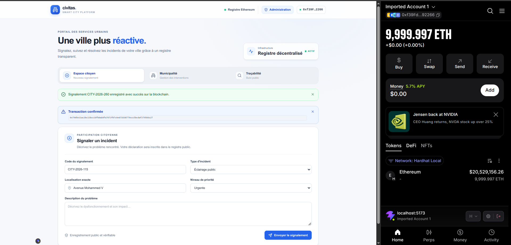
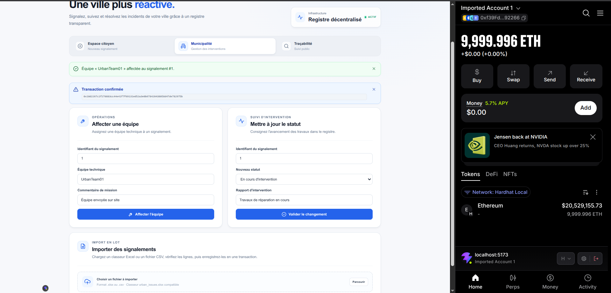
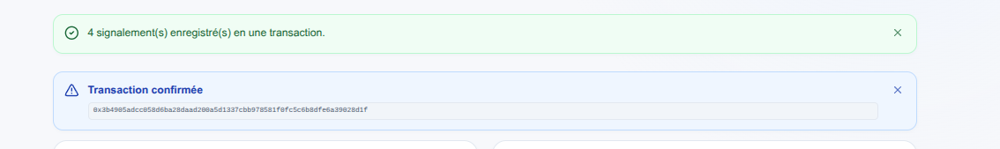

# 🏙️ Civitas : Plateforme Décentralisée de Gestion des Services Urbains (Smart City & Blockchain)

Application décentralisée (DApp) complète permettant aux citoyens de signaler des dégradations urbaines et aux services municipaux d'assurer leur prise en charge avec un historique d'intervention infalsifiable sur la blockchain Ethereum.

---

## 📌 Architecture du Projet

```text
MiniProjet_SmartCity/
├── contracts/
│   └── UrbanIssueRegistry.sol      # Smart Contract (Cycle de vie, Historique, Traçabilité, Batch)
├── test/
│   └── UrbanIssueRegistry.test.ts  # Tests unitaires automatisés (6/6 tests réussis)
├── scripts/
│   └── deploy.ts                   # Script de déploiement Hardhat 3
├── frontend/                       # DApp Web3 React + Vite (Design Civitas SaaS & SVG Icons)
│   ├── src/
│   │   ├── contractConfig.js       # Configuration (Adresse & ABI du registre)
│   │   ├── App.jsx                 # Application (Espace Citoyen, Mairie & Traçabilité)
│   │   └── App.css                 # Interface utilisateur moderne
├── urban_issues.xlsx               # Fichier Excel modèle de signalements (9 colonnes)
├── hardhat.config.ts               # Configuration Hardhat (viaIR activé)
└── README.md
```

---

## ⚙️ Prérequis et Installation

- **Node.js** : version 22.x ou supérieure (`nvm use 22`)
- **MetaMask** : extension connectée au réseau local Hardhat (`http://127.0.0.1:8545`, Chain ID `31337`).

### 1. Installation des dépendances

```bash
# Dépendances Hardhat (à la racine de MiniProjet_SmartCity)
npm install

# Dépendances Frontend (React + Vite + SheetJS + ethers)
cd frontend
npm install
cd ..
```

---

## 🧪 Tests Unitaires Automatisés

Le Smart Contract valide l'intégralité du cycle de vie des incidents (`Reported` ➔ `Assigned` ➔ `InProgress` ➔ `Resolved` ➔ `Closed`), la traçabilité de chaque action, la règle anti-doublon et l'enregistrement groupé.

Exécuter la suite de tests :

```bash
npx hardhat test
```

**Résultat :**
```text
  UrbanIssueRegistry - Tests Unitaires & Cycle de Vie Smart City
    ✔ 1. Un citoyen peut déclarer un signalement (statut initial = Reported)
    ✔ 2. La municipalité peut affecter une équipe (statut passe à Assigned)
    ✔ 3. Sécurité : Un utilisateur non autorisé ne peut pas affecter ni modifier le statut
    ✔ 4. Traçabilité : Enregistre chronologiquement chaque étape du traitement
    ✔ 5. Sécurité : Rejette un signalement avec un code d'incident déjà existant
    ✔ 6. L'importation groupée (Batch) enregistre correctement plusieurs pannes

  6 passing (400ms)
```

---

## 🚀 Déploiement du Smart Contract

### Étape 1 : Démarrer la Blockchain locale (Terminal 1)
```bash
npx hardhat node
```

### Étape 2 : Déployer le contrat (Terminal 2)
```bash
npx hardhat run scripts/deploy.ts --network localhost
```
- **Adresse déployée :** `0x5FbDB2315678afecb367f032d93F642f64180aa3`
- **Autorité Municipale (Admin) :** `0xf39Fd6e51aad88F6F4ce6aB8827279cffFb92266`

---

## 💻 Démarrage de la Plateforme Civitas

Dans un nouveau terminal :
```bash
cd frontend
npm run dev
```
Accès : `http://localhost:5173/`.

---

## 📸 Démonstration en Images (Cycle de Vie Complet)

### 1. Espace Citoyen : Déclaration d'un Incident
Le citoyen déclare une panne d'éclairage public (`CITY-2026-260`) enregistrée on-chain :



### 2. Services Municipaux : Affectation d'Équipe
La mairie assigne l'équipe technique `UrbanTeam01` au signalement #1 :



### 3. Services Municipaux : Mise à Jour du Statut
Changement d'état vers `InProgress` avec consignation du rapport de travaux :


### 4. Importation Massive Excel (urban_issues.xlsx)
SheetJS extrait les signalements et les enregistre simultanément en une seule transaction Batch :



### 5. Traçabilité & Journal d'Audit Public (Partie 4 du sujet)
Consultation publique affichant la timeline chronologique certifiée par la blockchain :

