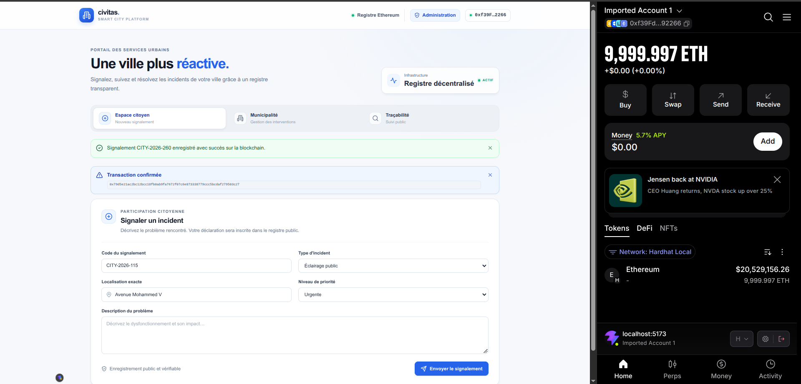
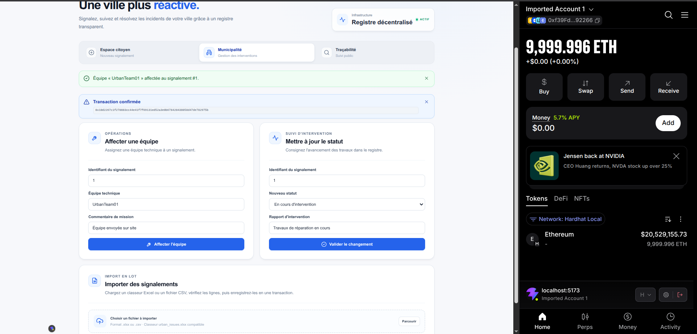
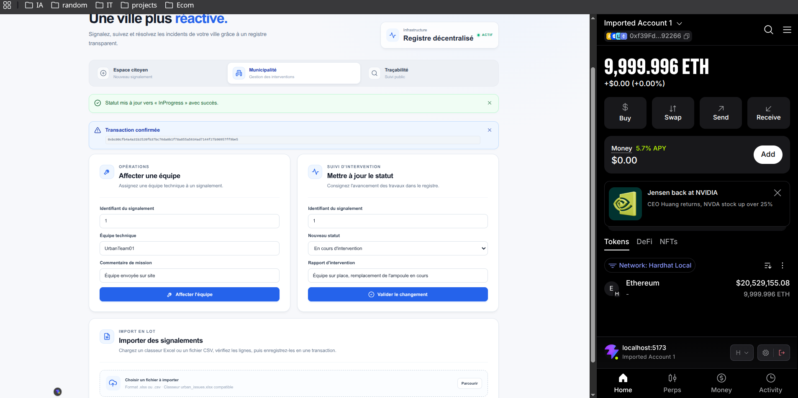
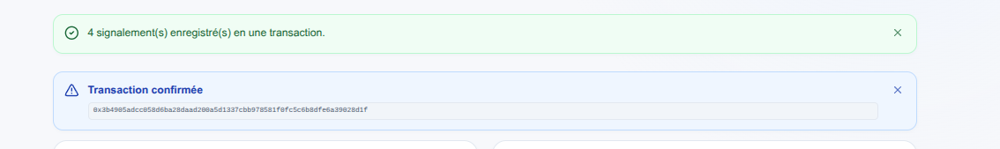

# Mini-Projet-Smart-City-Blockchain

<!-- ========================================== -->
<!-- MINI-PROJET : SMART CITY & BLOCKCHAIN -->
<!-- ========================================== -->

<b>Mini-Projet: Smart City & Blockchain (Gestion des Services Urbains)</b> | <a href="MiniProjet_SmartCity"><code>MiniProjet_SmartCity</code></a> | $\color{red}{\text{(Click to open / close)}}$

 

> 🏙️ **Documentation Technique & Guide du Mini-Projet :**  
> Retrouvez le guide complet d'installation et d'utilisation de la plateforme Civitas dans : [`MiniProjet_SmartCity/README.md`](MiniProjet_SmartCity/README.md).

 

**Plateforme décentralisée complète de gestion du cycle de vie des incidents urbains (Citoyens ➔ Mairie ➔ Équipes d'intervention) avec traçabilité absolue et importation de données Excel.**

- **Smart Contract & Historique** : [`MiniProjet_SmartCity/contracts/UrbanIssueRegistry.sol`](MiniProjet_SmartCity/contracts/UrbanIssueRegistry.sol) *(6/6 tests unitaires validés)*.
- **Application Web3 Civitas (React + Vite)** : [`MiniProjet_SmartCity/frontend/src/App.jsx`](MiniProjet_SmartCity/frontend/src/App.jsx).
- **Modèle de Données Excel** : [`MiniProjet_SmartCity/urban_issues.xlsx`](MiniProjet_SmartCity/urban_issues.xlsx).
- **Adresse Déployée (Hardhat Local)** : `0x5FbDB2315678afecb367f032d93F642f64180aa3`.

---

#### Démonstration du Cycle de Vie Urbain :

**1. Déclaration citoyenne d'une panne d'éclairage public :**

**2. Affectation de l'équipe technique par la municipalité :**

**3. Mise à jour du statut vers InProgress avec rapport d'intervention :**

**4. Importation massive Excel (.xlsx) et enregistrement en lot :**

**5. Journal de traçabilité infalsifiable & historique complet des interventions :**

---

---